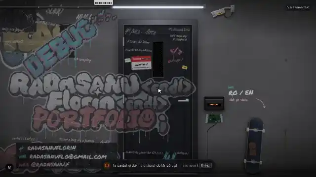
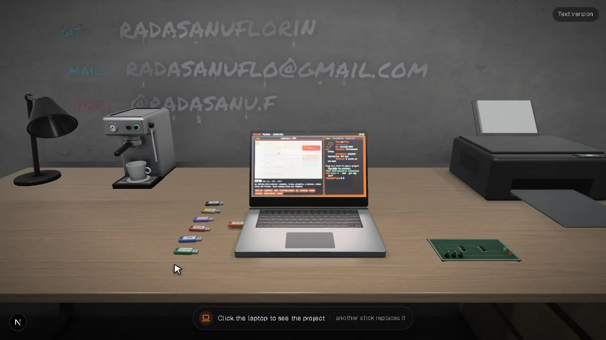
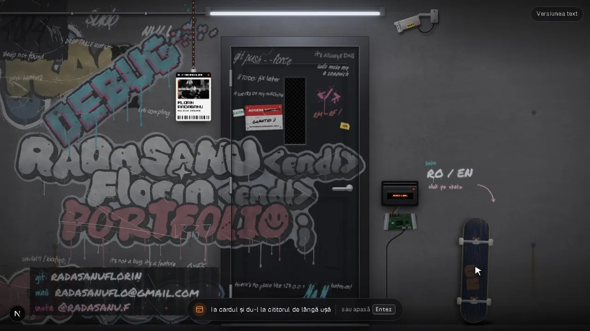
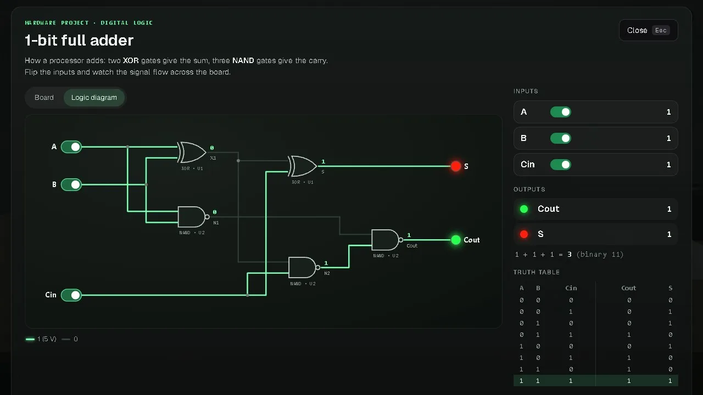

# 🏢 radasanuf.com · a CV you walk into

  
  
  
  
  
  

> This is a showcase repository. The source code is kept in a private repository. **The site itself is live at [radasanuf.com](https://radasanuf.com).**

My portfolio, built as a place instead of a page. You swipe an access card at a basement door, walk into an office and
sit down at the desk: the projects are USB sticks you plug into a laptop, the CV comes out of a printer, and everything
in the room does something. The whole scene is ray traced in the browser with WebGL 2, without a single 3D model file.

  

<a href="./docs/demo.mp4">▶ The full walk-through (1:42)</a>

## What's in the room

- **The hall:** an access card on a lanyard, swiped through a reader by the door, and contact details sprayed on the wall as graffiti (each line is a link).
- **The language switch is a skateboard:** it says RO or EN underneath; click it and it does a kickflip and lands on the other side, switching the whole site between Romanian and English.
- **The desk:** seven USB sticks, one per project. Drag one into the laptop and FlorinOS shows the project; leaning in opens a real terminal (`help`, `mount`, `git log`, `demo`…) and the projects' **live demos** with sample data.
- **The printer** prints the CV, page by page; you pick it up, read it and download it.
- **The whiteboard** on the left explains how the site is built, branch by branch, each with its "why".
- **The drawer** holds my path so far, handwritten on index cards.
- **A hardware project:** a 1-bit full adder (74HC86 XOR + 74HC00 NAND) on a green board. Flip the switches on the desk, or open the lab to watch the signal propagate gate by gate on the board and on the logic diagram, with the truth table alongside.
- **The small things:** a desk lamp that switches the ceiling lights off, an espresso machine that brews a coffee you can drag around the desk and drink.
- **A text version** of everything, for search engines, screen readers and browsers without WebGL.

  

<table>
<tr>
<td width="50%">
The hall at the door, before swiping the card
</td>
<td width="50%">
The adder's logic diagram, with the signal flowing
</td>
</tr>
</table>

## Under the hood

- **Ray traced in a fragment shader.** Every object is a signed distance function plus exact ray intersections: no meshes and no 3D files to download. Rendering runs in three passes (trace → shade → finish) and adds up rays per pixel while the camera rests, so light and soft shadows converge to a clean image.
- **Fast enough for a 360 Hz monitor:** about 5 ms per frame at 1080p on a Radeon RX 6600 XT, with the resolution adapting to the GPU while moving.
- **Built for the GPU compiler, too:** the shader starts compiling on the landing page; heavy materials get their part id through the G-buffer instead of re-evaluating geometry, which took the slowest program from 14 s to under 10 s on Windows, and the door only opens once the office can be drawn.
- **Textures drawn by code:** one 2048 px atlas (laptop, stick labels, CV pages, graffiti, whiteboard) and the hall graffiti are generated by scripts in a headless browser, with normal maps from height (Sobel).
- **One source of truth for the UI:** the desk is a state machine (seated, dragging, laptop, printing, page in hand) with tests, and every state has an address (`#cv`, `#ritm`), so Back and shared links work.
- **Two languages without a reload:** the visitor's language comes from their last choice, `?lang=en` or the browser; it is read after hydration, so the static page stays consistent.
- **Accessible:** everything works from the keyboard, screen readers get announcements for each step, and reduced motion is respected.
- **Almost serverless:** static Next.js on Cloudflare Workers (OpenNext), cookie-free counters, and demos that run entirely in the visitor's browser.

## Tech stack

Next.js 16 · React 19 · TypeScript · WebGL 2 / GLSL ES 3.0 · Web Audio · Node test runner · Playwright (asset scripts) · Cloudflare Workers · OpenNext

## Source code

The code is private. If you would like to see it, contact me through my [GitHub profile](https://github.com/radasanuflorin).
